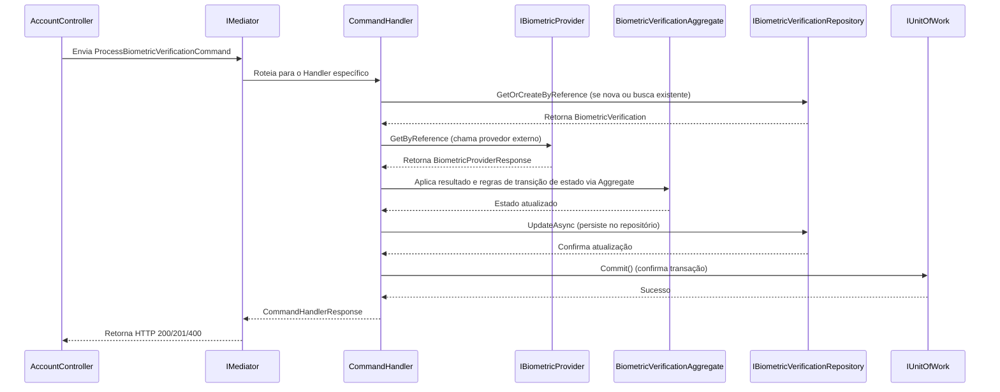

# Desafio Engeneharia Juvo

Bem vindo(a) a etapa de entrevista técnica da Juvo. A seguir você terá uma descrição sobre esse projeto e uma breve explicação sobre o setup básico. Após o setup temos a seção com o desafio. 
Boa sorte e nos vemos na entrevista!

## O que é este projeto? 

Serviço de contas responsável por acompanhar o resultado de verificações de biometria facial feitas em um provedor externo.

## Como utilizar o projeto

### Pré-requisitos

- [.NET SDK 8.0](https://dotnet.microsoft.com/download/dotnet/8.0)
- `curl` (no Windows, use `curl.exe` no PowerShell para não cair no alias `Invoke-WebRequest`)

### Compilar e executar

Na raiz do projeto (pasta onde está o `Account.sln`):

```bash
dotnet build Account.sln
dotnet run --project source/Account.Api
```

A API sobe em `http://localhost:5080`. Todos os dados ficam em memória e são perdidos ao reiniciar a aplicação.

### Chamadas HTTP

**Processar uma verificação de biometria**

```bash
curl -X POST http://localhost:5080/api/accounts/biometrics/verifications \
  -H "Content-Type: application/json" \
  -d '{"reference":"verification-approved-1"}'
```

**Consultar o estado de uma verificação**

```bash
curl http://localhost:5080/api/accounts/biometrics/verifications/verification-approved-1
```

No PowerShell, o corpo JSON precisa de aspas escapadas:

```powershell
curl.exe -X POST http://localhost:5080/api/accounts/biometrics/verifications `
  -H "Content-Type: application/json" `
  -d '{\"reference\":\"verification-approved-1\"}'

curl.exe http://localhost:5080/api/accounts/biometrics/verifications/verification-approved-1
```

Exemplo de resposta:

```json
{
  "id": "645948a4-3076-4121-919e-98c60cd6756a",
  "reference": "verification-approved-1",
  "status": "Approved",
  "resultDescription": null,
  "createDate": "2026-10-20T14:13:39.5061104Z",
  "updatedAt": "2026-10-20T14:13:39.5124870Z"
}
```

### Provedor simulado

Não existe integração real. O provedor em memória decide a resposta pelo texto contido na referência:

| A referência contém | O provedor responde |
| --- | --- |
| `approved` | `APPROVED` |
| `rejected` | `REJECTED` |
| `pending` | `PENDING` |
| qualquer outro texto | `PENDING` |

Exemplos de referências: `verification-approved-1`, `verification-rejected-2`, `verification-pending-3`.

## Contexto

O Account Service precisa consultar o resultado de uma verificação de biometria facial em um provedor externo. A API do provedor retorna um dos seguintes estados:

- `PENDING`: verificação em andamento.
- `APPROVED`: verificação aprovada.
- `REJECTED`: verificação reprovada.

## O desafio

### Etapa 1 — Processar o resultado

Implemente o componente que interpreta a resposta do provedor, persiste o resultado e permite que o sistema consulte o estado da verificação.

Ao receber a referência de uma verificação, o serviço deve:

1. Consultar o provedor por meio da interface já disponibilizada.
2. Converter a resposta externa para o modelo interno do domínio.
3. Persistir o estado usando o repositório.
4. Retornar o estado atualizado.

Depois de processada, a mesma referência deve ser consultável pelo endpoint de consulta, com o estado que foi persistido.

### Etapa 2 — Verificações pendentes

Algumas consultas ao provedor retornam `PENDING`, pois a verificação ainda está em processamento. A conclusão acontece de forma assíncrona e pode ficar disponível somente em uma consulta posterior.

Evolua a solução para que uma verificação pendente possa ser consultada novamente até atingir um estado final, sem manter a requisição HTTP original aberta durante todo o processamento.

Explicar o raciocínio e os trade-offs conta tanto quanto o código.

## Estrutura do projeto

A solution segue uma organização em camadas:

```
source/
├── Account.Api/       # Startup, injeção de dependência e controllers HTTP
├── Account.Domain/    # Entidades, enums, commands, aggregates e contratos
│   └── Framework/     # Classes base: Entity, CommandHandlerBase, IRepository, IMediator
├── Account.Data/      # Implementações em memória: repositório, queries, provedor e serviços externos
└── Account.Tasks/     # Jobs agendados
```

Fluxo de uma requisição:

```
Controller -> IMediator -> CommandHandler -> (Provider, Aggregate, Repository)
```

- Os commands ficam em `Account.Domain/Commands` e estendem `CommandHandlerBase`, que abre e confirma a transação e mapeia a entidade para o response.
- Alterações de estado nas entidades passam pelos aggregates em `Account.Domain/Aggregates`.
- Leituras usam as interfaces de `Account.Domain/Queries`; escritas usam `IRepository`.
- Interfaces de serviços externos ficam em `Account.Domain/Providers` e `Account.Domain/Services`, com implementações em `Account.Data`.

Fique à vontade para criar, alterar ou remover arquivos, inclusive nas camadas de framework, se fizer sentido para a solução.

## 4.1 — Fluxo Documentado: Controller -> Mediator -> Command -> Provider -> Aggregate -> Repo

O fluxo completo de uma requisição de escrita (Command) segue o padrão CQRS com Mediator, passando pelas seguintes camadas:

1. **AccountController** (Controller): Recebe o request HTTP, cria o `ProcessBiometricVerificationCommand` e envia via Mediator.
2. **IMediator**: Roteia o command para o handler apropriado usando reflection e injeção de dependência.
3. **ProcessBiometricVerificationCommand.Handler** (Command): Extende `CommandHandlerBase`, que:
   - Valida inputs (Guard Clauses)
   - Busca ou cria a entidade via `IBiometricVerificationRepository.GetOrCreateByReference`
   - Chama o **Provider** (`IBiometricProvider`) para obter o status do provedor externo
   - Mapeia a resposta do provedor para o status interno do domínio via `BiometricProviderStatusMapper`
   - Executa as regras de transição de estado no **Aggregate** (`BiometricVerificationAggregate.ApplyResult`)
   - Persiste as alterações no **Repository** (`BiometricVerificationRepository.UpdateAsync`)
   - Confirma a transação via `IUnitOfWork.CommitAsync`
4. **IBiometricProvider / FakeBiometricProvider** (Provider): Simula a chamada à API externa de biometria, retornando PENDING, APPROVED ou REJECTED baseado no texto da referência.
5. **BiometricVerificationAggregate** (Aggregate): Encapsula a lógica de negócio para transição de estado, garantindo consistência e regras de domínio.
6. **IBiometricVerificationRepository / BiometricVerificationRepository** (Repo): Abstracts the data access, responsável por salvar/obter as entidades (em memória ou banco de dados persistente).



## 4.2 — Limitações Conhecidas

### Dados voláteis (em memória)
- **Problema:** Todos os dados de verificação de biometria são armazenados em memória RAM (`BiometricVerificationStore`). Ao reiniciar a aplicação, todos os registros são perdidos.
- **Impacto:** Em caso de reinício ou escalonamento horizontal, o estado atual das verificações não é mantido. Requisições pendentes (`PENDING`) precisariam ser reprocessadas do zero.
- **Solução para produção:** Persistência em banco de dados relacional (PostgreSQL, SQL Server) ou banco de dados NoSQL (CosmosDB, MongoDB) com conexão Entity Framework ou Dapper. O repositório e as stores atuais seriam substituídos por implementações que se conectam a um banco de dados persistente.

### Ausência de mensageria real (RabbitMQ/Azure Service Bus)
- **Problema:** O job assíncrono `SyncBiometricVerificationsJob` é executado via `ScheduledJobHostedService` com um cron definido (`0 */15 * * * *`), rodando dentro do próprio processo da API (`BackgroundService`). Não há um broker de mensageria separado para desacoplar a produção do consumo.
- **Impacto:** O job só é executado quando a aplicação está rodando. Em ambiente de produção com múltiplas instâncias, pode haver competição ou processamento duplicado entre instâncias. Não há fila para buffered processing ou retry automático.
- **Solução para produção:**
  - Integração com **RabbitMQ** ou **Azure Service Bus**: Publicar mensagens de `PENDING` verificações em uma fila/topic assim que são criadas.
  - Workers independentes consumindo dessas filas, permitindo escalabilidade horizontal.
  - Mensageria durável com *dead-letter queue* para falhas retry.
  - Utilizar o recurso de *lease* do Service Bus para garantir que apenas uma instância processe cada verificação.

### Como seria resolvido em produção
1. **Persistência:** Substituir `BiometricVerificationStore` (dicionário em memória) por EF Core com migrations e banco de dados dedicado.
2. **Mensageria:** Ao criar uma verificação com status `PENDING`, publicar uma mensagem em uma fila Service Bus/RabbitMQ contendo a referência.
3. **Workers:** Serviços separados (ou funções serverless) consumindo a fila a cada X minutos, processando as verificações pendentes e atualizando o status no banco.
4. **Idempotência:** Garantir que o repositório tenha um mecanismo de idempotência (como `GetOrCreateByReference` já faz em memória, mas estendido para banco de dados com transactions isoladas).
5. **Monitoramento:** Logs estruturados, métricas de tempo de processamento e alertas para jobs com falhas consecutivas.
